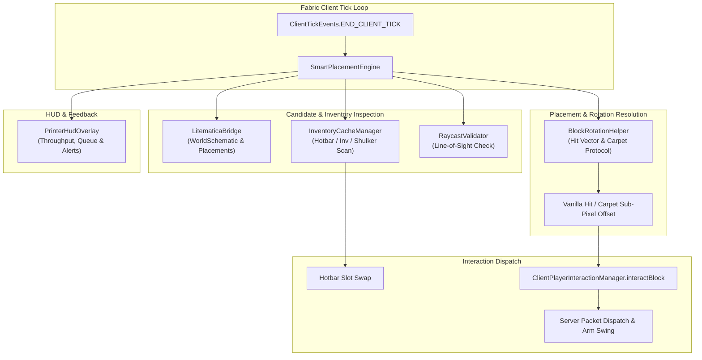

# ⚡ Litematica Printer Pro

[](https://fabricmc.net/)
[](https://fabricmc.net/)
[](https://adoptium.net/)
[](LICENSE)

**Litematica Printer Pro** is a high-performance Fabric companion mod for Masa's [Litematica](https://github.com/maruohon/litematica). It introduces an intelligent auto-placement engine featuring dependency-aware topological ordering, accurate sub-block rotation resolution, Carpet Accurate Placement protocol v2/v3 support, and inventory buffer caching.

---

## 🚀 Key Features

- **⚡ Smart Auto-Placement Engine**
  - High-throughput placement bursts configurable from 1 to 20 blocks per tick.
  - Topological dependency awareness: builds bottom-to-top and guarantees solid support blocks are placed prior to attaching torches, redstone dust, repeaters, rails, and ladders.
  - Collision-aware safety checks to prevent self-suffocation or placing inside the player bounding box.

- **🔄 Accurate Block Rotation Resolution**
  - Precise hit-vector calculations for directional blocks including stairs, slabs, observers, pistons, hoppers, dispensers, droppers, and trapdoors.
  - Native integration with **Carpet / Masa Accurate Block Placement Protocol (v2 & v3)**, enabling flawless block facings without requiring frantic player camera twisting.

- **🎒 High-Speed Inventory Buffer Caching**
  - Caches hotbar and main inventory slots to eliminate scan latency during 20+ bps build runs.
  - Seamless automatic hotbar slot swapping directly from main inventory.
  - Deep shulker box inspection cache to notify you when materials run out and indicate which container holds them.

- **🛡️ Server Anti-Cheat Friendly**
  - Optional `strictRaycast` line-of-sight validation ensures every placement action conforms to standard server camera visibility requirements.
  - Strict range boundaries preventing reach limit disconnects.

- **🖥️ Real-time On-Screen HUD**
  - Live readout displaying printer status (Active / Standby), remaining queue size, placement throughput (bps / bpt), and missing item alerts.

---

## 📐 Architecture Diagram



---

## ⌨️ Keybinding Cheatsheet

| Keybinding | Default Key | Action |
| :--- | :--- | :--- |
| **Toggle Printer** | `V` | Toggles automatic schematic block placement on or off. |
| **Cycle Placement Speed** | `B` | Cycles burst throughput through `1` ➔ `3` ➔ `5` ➔ `10` blocks/tick. |
| **Open MaLiLib Config** | `M + C` | Opens the MaLiLib in-game configuration menu. |

*(All keybindings can be customized in the vanilla Controls ➔ Key Binds menu under the `Litematica Printer Pro` category).*

---

## ⚙️ Configuration Options

Configuration can be modified via the MaLiLib in-game config GUI or by editing `.minecraft/config/litematica_printer_pro.json`:

```json
{
  "printerEnabled": false,
  "placementRange": 4.5,
  "blocksPerTick": 3,
  "placementIntervalTicks": 1,
  "smartRotationEnabled": true,
  "carpetAccuratePlacement": true,
  "inventoryBufferCache": true,
  "breakWrongBlocks": false,
  "strictRaycast": false,
  "showHud": true,
  "hudPosX": 10,
  "hudPosY": 10
}
```

### Detailed Option Reference

- `printerEnabled` (*boolean*, default: `false`): Master switch for the placement loop.
- `placementRange` (*double*, default: `4.5`): Maximum spherical reach distance from player camera (1.0 to 6.0).
- `blocksPerTick` (*integer*, default: `3`): Maximum blocks placed per client tick (1 to 20).
- `placementIntervalTicks` (*integer*, default: `1`): Delay in ticks between placement cycles (`0` for uncapped every tick).
- `smartRotationEnabled` (*boolean*, default: `true`): Calculates optimal hit vectors for directional blocks.
- `carpetAccuratePlacement` (*boolean*, default: `true`): Uses the Carpet protocol for exact block state placement.
- `inventoryBufferCache` (*boolean*, default: `true`): Pre-indexes inventory items for instant hotbar swapping.
- `breakWrongBlocks` (*boolean*, default: `false`): Automatically breaks wrong or misplaced blocks.
- `strictRaycast` (*boolean*, default: `false`): Requires unobstructed line-of-sight between player and target block face.
- `showHud` (*boolean*, default: `true`): Displays the status HUD on the screen.

---

## 📦 Installation & Setup

### Requirements
- **Minecraft**: `1.21.4`
- **Fabric Loader**: `>=0.16.10`
- **Fabric API**: `>=0.115.0+1.21.4`
- **MaLiLib**: `>=0.21.0`
- **Litematica**: `>=0.19.50`
- **Java**: `21` or higher

### Steps
1. Install [Fabric Loader](https://fabricmc.net/use/) for Minecraft 1.21.4.
2. Download and place `fabric-api`, `malilib`, `litematica`, and `litematica-printer-pro-1.0.0.jar` into your `.minecraft/mods` folder.
3. Launch Minecraft.
4. Load your schematic in Litematica and position it in the world.
5. Press `V` to activate **Litematica Printer Pro** and start building!

---

## 🛠️ Building from Source

```bash
# Clone the repository
git clone https://github.com/slopggobblercobbler81/litematica-printer-pro.git
cd litematica-printer-pro

# Build mod jar using Gradle
./gradlew build
```

Compiled jar files are located in `build/libs/`.

---

## 📄 License

This project is licensed under the [MIT License](LICENSE).
